<div align="center">

# BlueStore
### E-commerce Experience & Sales Analytics Dashboard

**A bilingual storefront and data-driven administration dashboard**

[](https://dani-labbafi.github.io/test3/)
[](https://github.com/dani-labbafi/test3)

**English · فارسی**

</div>

---

## Table of Contents

- [Project Overview](#project-overview)
- [Key Features](#key-features)
- [Application Walkthrough](#application-walkthrough)
  - [1. Storefront](#1-storefront)
  - [2. Product Catalog](#2-product-catalog)
  - [3. Product Details](#3-product-details)
  - [4. Shopping Cart and Checkout](#4-shopping-cart-and-checkout)
  - [5. Order Tracking](#5-order-tracking)
  - [6. Admin Dashboard](#6-admin-dashboard)
  - [7. Analytics and Charts](#7-analytics-and-charts)
  - [8. Product Management](#8-product-management)
  - [9. Order Management](#9-order-management)
  - [10. Price Tier Analysis](#10-price-tier-analysis)
  - [11. Management Insights](#11-management-insights)
  - [12. System and Data Limitations](#12-system-and-data-limitations)
- [Technology Stack](#technology-stack)
- [Project Structure](#project-structure)
- [Data and Analytical Methods](#data-and-analytical-methods)
- [Run Locally](#run-locally)
- [Current Scope and Limitations](#current-scope-and-limitations)
- [Project Team](#project-team)
- [فارسی](#فارسی)

---

## Project Overview

**BlueStore** is a browser-based e-commerce demonstration project that combines a customer-facing online storefront with an administrative dashboard for exploring sales data.

The customer interface supports product discovery, product details, a shopping cart, checkout-form interaction, and order lookup. The administration interface provides product- and order-level views, interactive charts, price segmentation, and management-oriented summaries.

The project is designed to demonstrate how a lightweight web interface can bring together an online shopping flow and practical sales analytics in one application.

> **Important:** BlueStore is a front-end project. It does not currently use a remote application server or a shared database. Browser-created orders are stored locally in the browser.

## Key Features

| Area | Capabilities |
|---|---|
| Bilingual interface | English and Persian interface support |
| Storefront | Product browsing, search, sorting, and price filters |
| Product details | Product information, sales indicators, quantity selection |
| Shopping flow | Cart management and checkout form |
| Order lookup | Search for locally available order records |
| Admin dashboard | KPI overview and global filters |
| Sales analytics | Time trends, country breakdowns, distributions, comparisons |
| Product analysis | Product-level metrics, sorting, filtering, CSV export |
| Order analysis | Order search, source filtering, detail view, CSV export |
| Price segmentation | Four configurable price tiers and revenue-share analysis |
| Data handling | Local browser storage for orders created in the current browser |

---

# Application Walkthrough

The screenshots below are captured from the project interface. Add the corresponding image files to a `screenshots/` directory in the repository using the filenames shown in each section.

## 1. Storefront

**Purpose:** Introduce the store, provide access to the main shopping areas, and present a high-level snapshot of the available sales dataset.


### What it includes

- **Brand and navigation:** Access to the storefront, order tracking, and administration area.
- **Language selection:** Switch between the English and Persian interface.
- **Store introduction:** A prominent introductory area that establishes the store identity.
- **Store statistics:** Summary indicators such as product count, units sold, orders, and countries represented in the available data.
- **Product discovery controls:** Search, sorting, and price-based filtering tools.

### How it works

The storefront loads the product catalogue in the browser and provides controls for narrowing and organizing the displayed products. The summary indicators are based on the project data rather than a live connection to a commercial sales platform.

### Why it matters

A clear storefront helps visitors understand the catalogue and find products efficiently. The summary indicators also provide context about the dataset before users explore individual products.

## 2. Product Catalog

**Purpose:** Help customers browse, search, sort, and compare products before opening a product page.

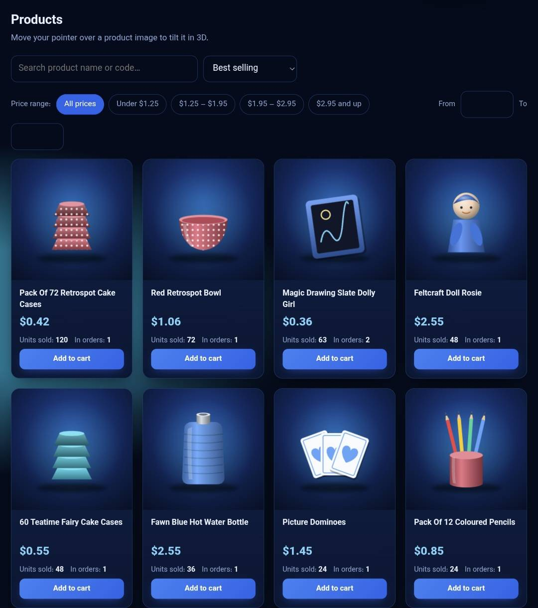

### Main capabilities

- **Product search:** Search using a product name or product code.
- **Sorting:** Organize products using the available sorting options, including best-selling order.
- **Price filters:** Select a predefined price range or enter a custom minimum and maximum price.
- **Product cards:** View product images, names, prices, and available sales indicators.
- **Quick cart action:** Add a product to the shopping cart from the catalogue.
- **Interactive presentation:** Product cards include visual interaction effects.

### Business value

Search and filtering reduce the effort required to navigate a catalogue. Product-level sales indicators add context to the browsing experience by showing how products have performed in the available data.

## 3. Product Details

**Purpose:** Present a focused view of an individual product and provide the actions needed to add it to the cart.

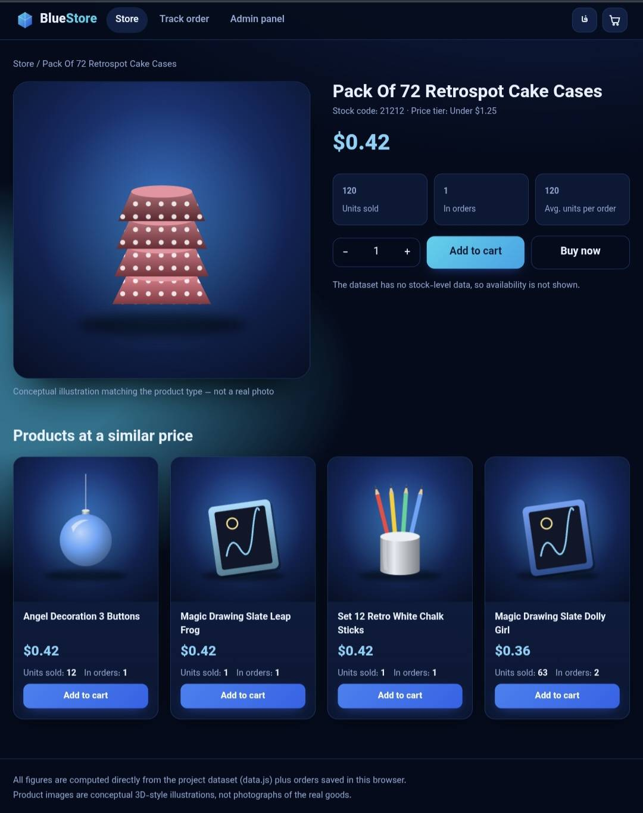

### Information and actions

- Product name and product code
- Product image and unit price
- Available product information
- Sales indicators, where available
- Quantity selection
- Add-to-cart action
- Buy-now action
- Similar-product suggestions

The page combines product information with a direct shopping action. Sales indicators are descriptive metrics from the dataset; they should not be interpreted as live inventory information.

## 4. Shopping Cart and Checkout

**Purpose:** Let customers review selected products, adjust quantities, and enter the information requested by the checkout form.

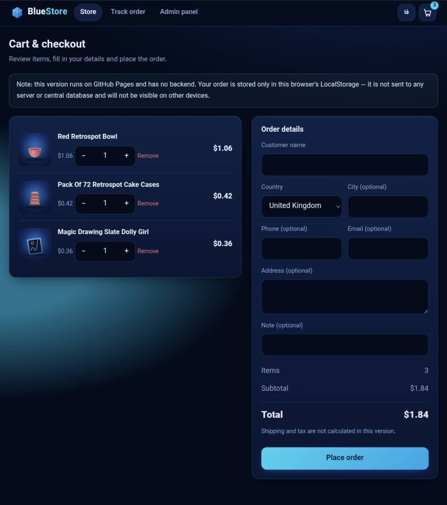

### Cart management

- Review selected products.
- Increase or decrease product quantities.
- Remove products from the cart.
- Review item prices and the order subtotal.

### Checkout form

The form provides fields for customer details such as name and country, with additional optional contact and address information and an order-notes field.

### Order summary

The checkout view summarizes the selected items and the calculated order amount before the customer submits the form.

**Implementation note:** In the current front-end version, submitting an order does not send it to a remote server or payment provider. Browser-created order records are stored in the current browser's local storage.

## 5. Order Tracking

**Purpose:** Find and display an order record using its order code.

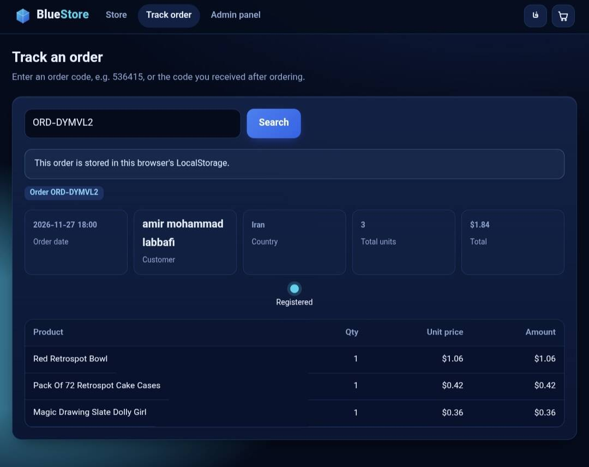

When a matching order record is available to the current browser, the tracking page can display information such as:

- Order identifier and date
- Customer and destination information available in the record
- Order summary
- Products and quantities
- Unit prices and line totals

The tracking experience is limited to records available to the application in that browser. It is not connected to a carrier, warehouse, or remote order-management service.

> Before publishing screenshots publicly, remove or obscure personal information and example order identifiers.

## 6. Admin Dashboard

**Purpose:** Provide an overview of the available sales data and a common set of filters for the analytical sections.

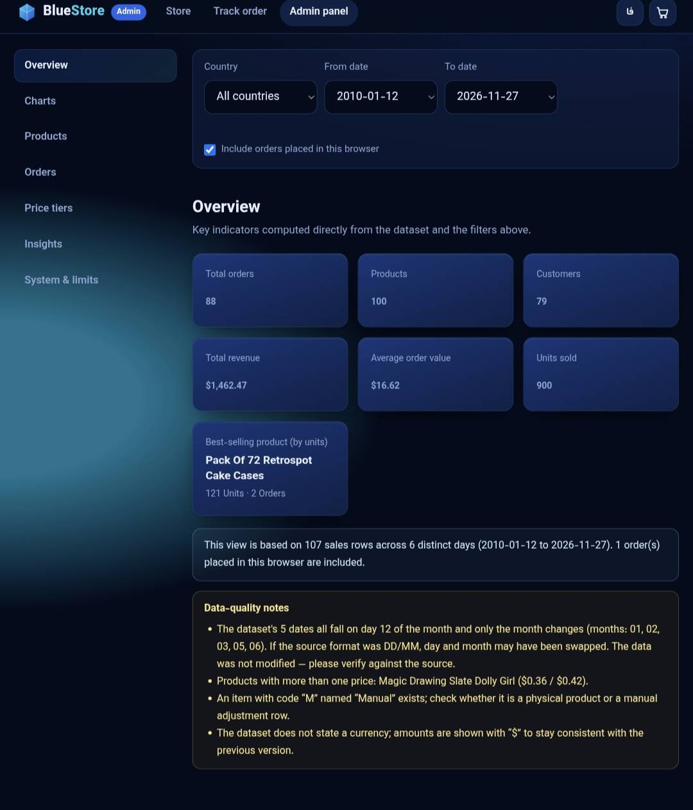

### Navigation

The administration area is organized into the following sections:

- **Overview**
- **Charts**
- **Products**
- **Orders**
- **Price Tiers**
- **Insights**
- **System & Limits**

### Global filters

The dashboard provides shared filters such as country and date range. It also includes an option to determine whether orders placed in the current browser should be included in the analysis.

### KPI overview

The overview presents high-level indicators, including:

- Number of orders
- Number of products
- Number of customers represented in the data
- Revenue
- Average order value
- Units sold
- Top product by units sold

The displayed figures depend on the selected filters and the data available to the application.

### Data scope and quality

The overview also communicates information about the selected data scope and highlights known data-quality considerations. This is important because analytical results are only as reliable as the underlying data.

## 7. Analytics and Charts

**Purpose:** Explore sales activity from different perspectives using interactive visualizations.

### 7.1 Sales trends and revenue

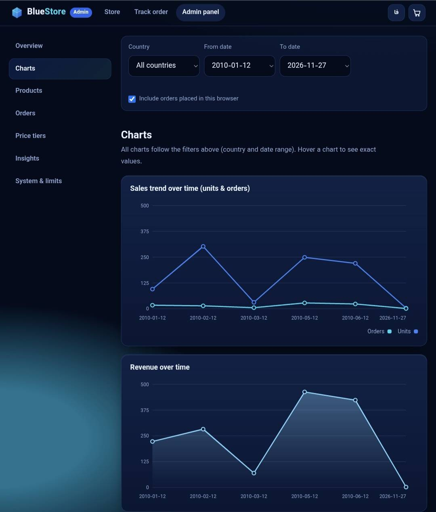

- **Sales Trend (Units & Orders):** Compare the number of units sold and orders over time.
- **Revenue Over Time:** Explore how recorded revenue changes across the available dates.

These charts help users inspect the time distribution of the recorded activity. They do not establish a long-term market trend beyond the coverage of the dataset.

### 7.2 Product and market analysis

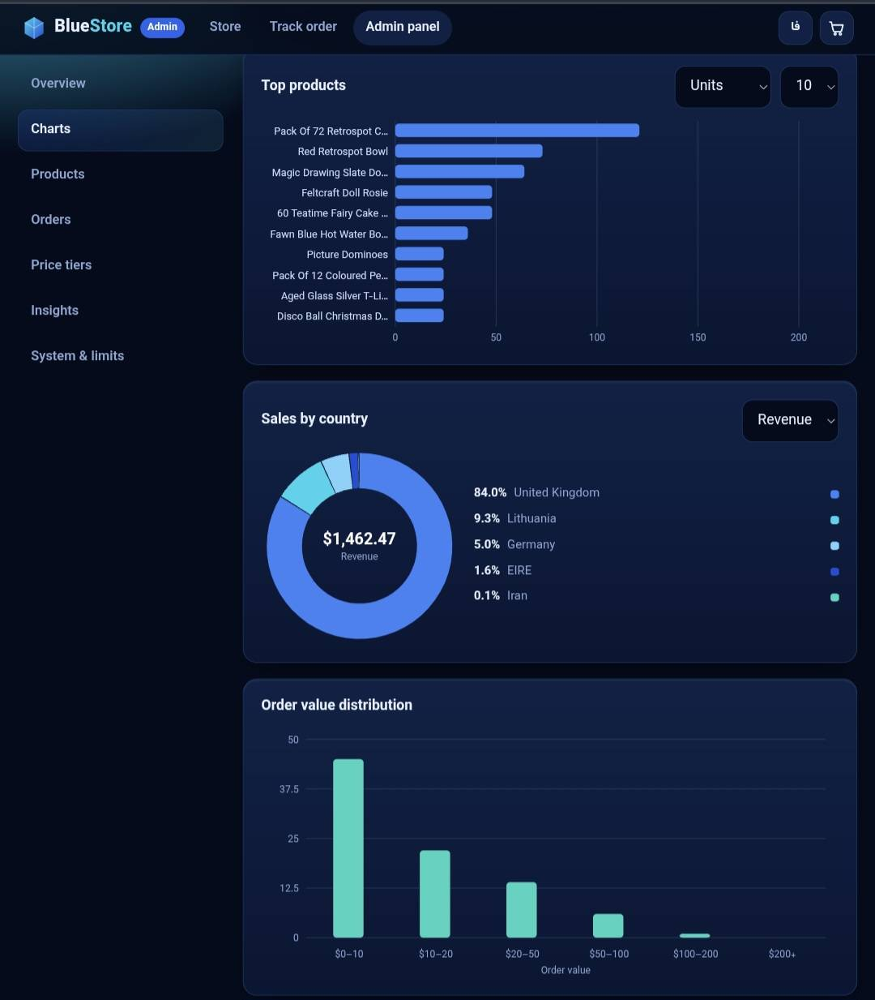

- **Top Products:** Rank products using the selected sales metric.
- **Sales by Country:** Compare the contribution of countries using the selected measure.
- **Order Value Distribution:** Examine how order values are distributed across value ranges.

These views help identify products and markets that contribute more strongly to the observed sales activity.

### 7.3 Time and product comparison

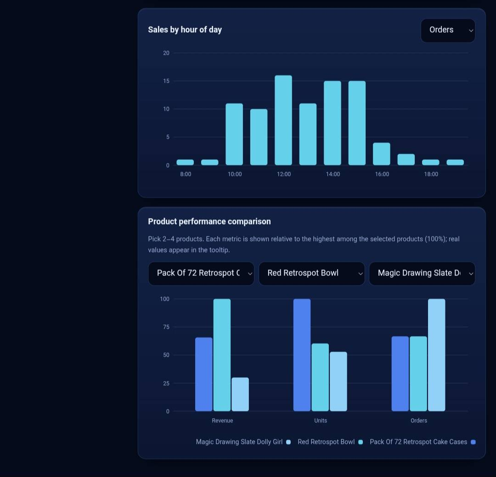

- **Sales by Hour of Day:** Inspect the distribution of orders or sales across hours.
- **Product Performance Comparison:** Compare a selection of products using metrics such as revenue, units, and orders.

The product comparison view supports comparison of multiple selected products. Where values are normalized for visual comparison, the chart should be read as a relative comparison; the tooltip provides the underlying values.

### Shared chart behavior

The charts respond to the dashboard's shared filters where applicable. Interactive tooltips provide additional detail when users inspect chart elements.

## 8. Product Management

**Purpose:** Explore product-level performance in a searchable, filterable table.

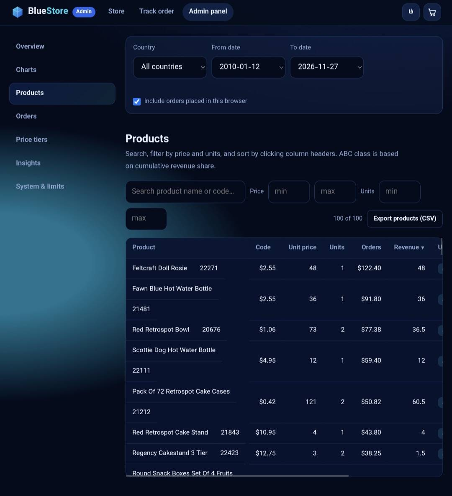

### Search and filters

- Search by product name or stock code.
- Filter by minimum and maximum unit price.
- Filter by minimum and maximum units sold.
- Sort table records using available table controls.

### Product performance table

The table includes product-level measures such as:

- Product name and stock code
- Unit price
- Units sold
- Number of orders
- Revenue
- Units per order
- ABC classification

### ABC classification

Products are classified using their cumulative contribution to revenue:

- **Class A:** Products up to the 80% cumulative-revenue threshold.
- **Class B:** Products between the 80% and 95% cumulative-revenue thresholds.
- **Class C:** Remaining products.

This is a prioritization view based on revenue contribution. It is not, by itself, a measure of profitability, strategic importance, or inventory criticality.

### Export

Filtered product records can be exported as a CSV file for additional analysis.

## 9. Order Management

**Purpose:** Search and inspect order records and distinguish between the original dataset and orders created in the current browser.

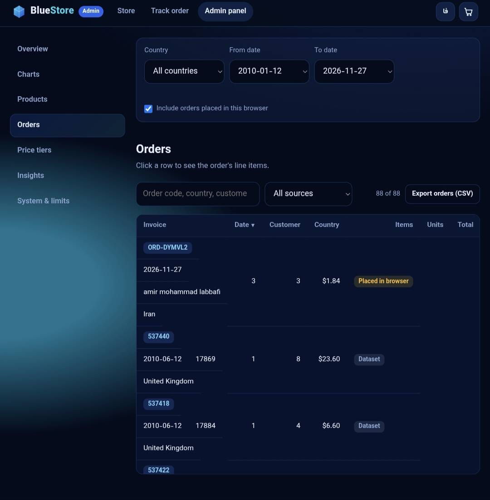

### Main capabilities

- Search by invoice/order identifier and available customer or country information.
- Filter by order source.
- Review order date, customer, country, item count, units, and total value.
- Open an order to inspect its line items.
- Export order records in CSV format.

### Order sources

The interface distinguishes between:

- **Dataset:** Records originating from the supplied project dataset.
- **Placed in browser:** Orders created through the storefront in the current browser.

This distinction is important when interpreting totals because locally created orders and original dataset records have different origins.

## 10. Price Tier Analysis

**Purpose:** Group products into price segments and compare each segment's share of products and revenue.

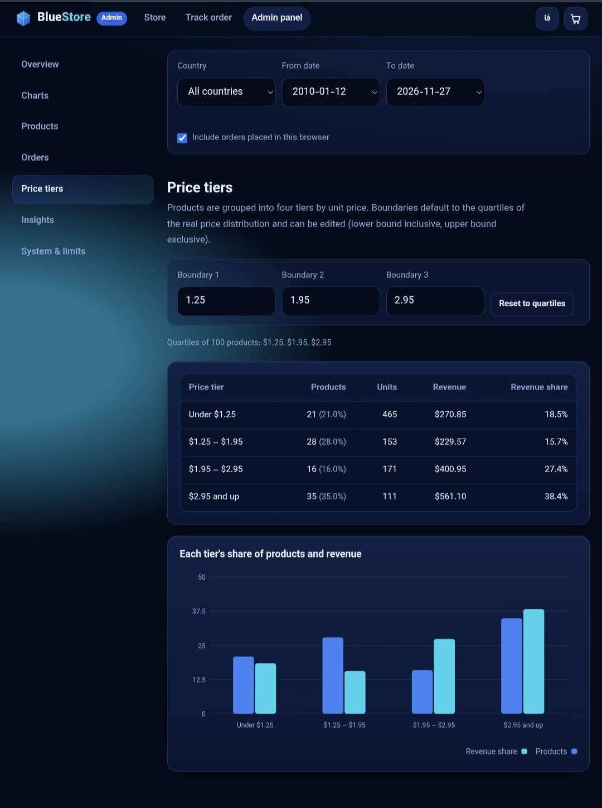

### Configurable price boundaries

Products are assigned to four price tiers using three boundaries. The initial boundaries are based on quartiles of the product-price distribution. Users can adjust the boundaries and restore the quartile-based defaults.

### Metrics by tier

For each price tier, the dashboard displays:

- Number and percentage of products
- Units sold
- Revenue
- Share of total revenue

### Comparative visualization

The chart compares each tier's share of the product catalogue with its contribution to total revenue.

### Management use

This view can support analysis of the product price mix and help users investigate how different price segments contribute to recorded revenue. It does not calculate margin or profit because product cost data is not available in the current project scope.

## 11. Management Insights

**Purpose:** Turn product and sales metrics into concise observations that can support further investigation and management discussion.

The Insights section includes analytical views such as:

- **ABC / Pareto analysis:** Classify products according to cumulative revenue contribution.
- **Best sellers:** Highlight leading products by units sold.
- **Low-selling products:** Identify products with relatively low recorded sales, subject to the available observation period.
- **Time patterns:** Summarize busy hours or days where the data supports this analysis.
- **Bulk demand:** Surface products or orders with higher unit quantities.
- **Manager attention:** Bring selected patterns or data limitations to the user's attention.

These are descriptive, rule-based insights from the available records. They should not be interpreted as predictive forecasts or as automated business recommendations.

## 12. System and Data Limitations

**Purpose:** Make the application's data handling and technical boundaries transparent.

The System & Limits section documents how order records are handled in the current browser and distinguishes original dataset records from locally created orders.

Current implementation notes include:

- Browser-created orders use `localStorage`.
- Local orders are not automatically synchronized across browsers or devices.
- Local order data can be exported as JSON.
- Locally stored order data can be reset from the system interface.
- The original dataset has limitations that affect which analyses can be performed.

A shared production system would require a backend service, persistent database, authentication, and appropriate server-side order processing. Those components are outside the current front-end implementation.

---

## Technology Stack

| Technology | Role |
|---|---|
| HTML5 | Page structure and application views |
| CSS3 | Layout, styling, responsive presentation, and visual effects |
| JavaScript | Storefront behavior, dashboard logic, filtering, and interactions |
| Local Storage | Browser-local persistence for orders created in the current browser |
| CSV / JSON | Data export formats |
| GitHub Pages | Static project hosting |

## Project Structure

```text
.
├── index.html
├── product.html
├── cart.html
├── track.html
├── admin.html
├── css/
│   └── style.css
├── js/
│   ├── admin.js
│   ├── cart.js
│   ├── charts.js
│   ├── core.js
│   ├── i18n.js
│   ├── product.js
│   ├── shop.js
│   ├── track.js
│   └── ui.js
├── data.js
├── docs/
│   └── ARCHITECTURE.md
├── img/
│   └── products/
└── screenshots/
```

## Data and Analytical Methods

BlueStore uses a supplied sales/product dataset as the basis for its catalogue indicators and administrative analytics. The dashboard derives descriptive measures from the records available to the application.

Analytical methods and measures represented in the interface include:

- Aggregation of orders, units, and revenue
- Average order value
- Product-level sales and revenue summaries
- Sales and revenue trends over available dates
- Country-level sales breakdowns
- Order-value distribution
- Hour-of-day analysis
- Product comparison
- Quartile-based price segmentation
- ABC classification using cumulative revenue contribution

### Data interpretation

The source data does not provide every operational field that a real e-commerce or inventory system would require. In particular, the current application should not be presented as providing verified stock availability, product cost, profit, fulfillment status, or carrier shipment tracking.

Date coverage and data quality may also limit time-series and trend interpretations. The dashboard's outputs should therefore be understood as descriptive analysis of the supplied records, not as a complete representation of a live business.

## Run Locally

BlueStore is a static front-end project.

1. Clone or download the repository.
2. Open the project folder.
3. Start a local static server, or open `index.html` in a browser.
4. Open `admin.html` to access the administration dashboard.

For example, if Python is installed, run the following command from the project directory:

```bash
python -m http.server 8000
```

Then open:

```text
http://localhost:8000
```

## Current Scope and Limitations

BlueStore demonstrates a front-end shopping flow and descriptive sales analytics. It is not yet a production-ready commerce platform.

| Area | Current scope |
|---|---|
| Storefront | Browser-based product browsing and shopping interface |
| Orders | Browser-local order storage |
| Backend | Not currently implemented |
| Database | No shared remote database |
| Payments | No live payment gateway |
| Inventory | No verified real-time stock management |
| Shipping | No carrier integration or live shipment tracking |
| Analytics | Descriptive analysis of available dataset and local records |
| Authentication | No production-grade user authentication |

These limitations are documented to distinguish implemented functionality from possible future development.

## Project Team

BlueStore is a collaborative project developed by:

- **Amir Mohammad Labbafi** — امیر محمد لبافی
- **Mahshid Bagheri** — مهشید باقری
- **Yasaman Serajeddin Mir Ghaed** — یاسمن سراج الدین میر قائد
- **Amir Ali Ghorbani** — امیر علی قربانی

---

# فارسی

## معرفی پروژه

**BlueStore** یک پروژه فروشگاهی تحت وب است که رابط کاربری فروشگاه اینترنتی را با یک داشبورد مدیریتی برای بررسی و تحلیل داده‌های فروش ترکیب می‌کند.

در بخش فروشگاه، کاربر می‌تواند محصولات را مشاهده و جست‌وجو کند، جزئیات محصول را ببیند، محصولات را به سبد خرید اضافه کند و فرم ثبت سفارش را تکمیل کند. در بخش مدیریت نیز ابزارهایی برای بررسی شاخص‌های فروش، تحلیل نموداری، ارزیابی عملکرد محصولات، مدیریت سفارش‌ها و گروه‌بندی قیمتی ارائه شده است.

هدف پروژه، نمایش کاربرد فناوری‌های تحت وب در کنار تحلیل داده‌های فروش و فراهم‌کردن دیدی مدیریتی از اطلاعات موجود است.

> **نکته مهم:** نسخه فعلی BlueStore یک پروژه Front-end است و به سرور یا پایگاه داده مشترک متصل نیست. سفارش‌هایی که از طریق فروشگاه ثبت می‌شوند، در حافظه محلی همان مرورگر ذخیره می‌شوند.

## قابلیت‌های اصلی

- رابط کاربری دوزبانه فارسی و انگلیسی
- جست‌وجو، مرتب‌سازی و فیلتر محصولات
- نمایش صفحه جزئیات هر محصول
- مدیریت سبد خرید و فرم ثبت سفارش
- جست‌وجوی سفارش با شناسه سفارش
- داشبورد مدیریتی و شاخص‌های کلیدی عملکرد
- نمودارهای روند فروش و درآمد
- تحلیل عملکرد محصولات و کشورها
- جدول مدیریتی محصولات و سفارش‌ها
- خروجی CSV از اطلاعات محصولات و سفارش‌ها
- طبقه‌بندی ABC بر اساس سهم تجمعی درآمد
- گروه‌بندی محصولات بر اساس چارک‌های قیمت
- ذخیره محلی سفارش‌های ثبت‌شده در مرورگر

## راهنمای بخش‌های پروژه

### ۱. صفحه اصلی فروشگاه

صفحه اصلی نقطه ورود کاربران به فروشگاه است. در این صفحه، هویت بصری فروشگاه، منوی اصلی، امکان تغییر زبان، آمار کلی داده‌ها و ابزارهای اولیه جست‌وجو و فیلتر در دسترس قرار دارند.

این صفحه به کاربر کمک می‌کند ساختار فروشگاه و نمای کلی محصولات را بشناسد و مسیر مناسبی برای پیدا کردن کالای موردنظر انتخاب کند.

### ۲. فهرست محصولات

در این بخش محصولات در قالب کارت نمایش داده می‌شوند. کاربر می‌تواند با نام یا کد محصول جست‌وجو کند، محصولات را مرتب کند، بازه قیمت را مشخص کند و محصولات موردنظر را به سبد خرید اضافه کند.

نمایش برخی شاخص‌های فروش در کنار اطلاعات محصول، امکان آشنایی بیشتر با عملکرد ثبت‌شده محصولات را فراهم می‌کند.

### ۳. جزئیات محصول

صفحه جزئیات محصول اطلاعاتی مانند نام، کد، تصویر، قیمت و شاخص‌های فروش موجود را نمایش می‌دهد. کاربر می‌تواند تعداد موردنظر را انتخاب کند و محصول را به سبد خرید اضافه کند یا از گزینه خرید مستقیم استفاده کند.

اطلاعات فروش نمایش‌داده‌شده از داده‌های پروژه استخراج می‌شوند و نباید با موجودی واقعی انبار اشتباه گرفته شوند.

### ۴. سبد خرید و ثبت سفارش

در سبد خرید، محصولات انتخاب‌شده، تعداد، قیمت و مبلغ سفارش نمایش داده می‌شوند. کاربر می‌تواند تعداد محصولات را تغییر دهد یا کالایی را حذف کند.

فرم ثبت سفارش اطلاعاتی مانند نام و کشور را دریافت می‌کند و فیلدهای تکمیلی تماس، نشانی و توضیحات سفارش نیز در رابط کاربری در نظر گرفته شده‌اند.

در نسخه فعلی، ثبت سفارش به سرور یا درگاه پرداخت متصل نیست و اطلاعات سفارش در LocalStorage مرورگر ذخیره می‌شود.

### ۵. رهگیری سفارش

کاربر می‌تواند با واردکردن شناسه سفارش، رکورد متناظر را جست‌وجو کند. در صورت وجود سفارش در داده‌های قابل دسترس مرورگر، اطلاعاتی مانند تاریخ، خلاصه سفارش، اقلام، تعداد و مبالغ نمایش داده می‌شوند.

این قابلیت به سامانه شرکت حمل‌ونقل یا سرویس رهگیری آنلاین متصل نیست.

### ۶. داشبورد مدیریتی

داشبورد مدیریتی نقطه ورود به ابزارهای تحلیل پروژه است. منوی کناری شامل بخش‌های نمای کلی، نمودارها، محصولات، سفارش‌ها، گروه‌بندی قیمت، تحلیل مدیریتی و اطلاعات سامانه است.

فیلترهای عمومی مانند کشور و بازه زمانی، محدوده داده‌های مورد بررسی را تعیین می‌کنند. همچنین گزینه‌ای برای لحاظ‌کردن سفارش‌های ثبت‌شده در مرورگر فعلی وجود دارد.

در نمای کلی، شاخص‌هایی مانند تعداد سفارش‌ها، محصولات، مشتریان، درآمد، میانگین ارزش سفارش و تعداد واحدهای فروخته‌شده نمایش داده می‌شوند.

### ۷. نمودارها و تحلیل فروش

بخش Charts داده‌های فروش را از چند زاویه بررسی می‌کند:

- روند تعداد واحدهای فروخته‌شده و سفارش‌ها در طول زمان
- تغییرات درآمد در تاریخ‌های موجود
- محصولات برتر بر اساس معیار انتخاب‌شده
- سهم کشورهای مختلف از فروش
- توزیع ارزش سفارش‌ها
- الگوی سفارش‌ها در ساعت‌های مختلف روز
- مقایسه عملکرد چند محصول بر اساس درآمد، تعداد واحد و تعداد سفارش

این نمودارها ابزارهایی برای تحلیل توصیفی داده‌ها هستند. محدودیت بازه زمانی دیتاست باید هنگام تفسیر روندها در نظر گرفته شود.

### ۸. مدیریت و تحلیل محصولات

در بخش Products، اطلاعات محصولات در قالب یک جدول قابل جست‌وجو و فیلتر نمایش داده می‌شود. امکان جست‌وجو بر اساس نام یا کد محصول، فیلتر قیمت و تعداد فروش، مرتب‌سازی و دریافت خروجی CSV وجود دارد.

شاخص‌هایی مانند قیمت واحد، تعداد واحدهای فروخته‌شده، تعداد سفارش‌ها، درآمد، میانگین واحد در هر سفارش و طبقه‌بندی ABC در این بخش استفاده می‌شوند.

طبقه‌بندی ABC بر اساس سهم تجمعی محصولات از درآمد انجام می‌شود: گروه A تا آستانه ۸۰ درصد، گروه B از ۸۰ تا ۹۵ درصد و گروه C شامل محصولات باقی‌مانده است.

### ۹. مدیریت سفارش‌ها

این بخش امکان جست‌وجو و بررسی سفارش‌ها را فراهم می‌کند. اطلاعاتی مانند شناسه فاکتور، تاریخ، مشتری، کشور، تعداد اقلام، مجموع واحدها و مبلغ سفارش در جدول نمایش داده می‌شوند.

همچنین سفارش‌های موجود در دیتاست اولیه از سفارش‌هایی که در مرورگر فعلی ثبت شده‌اند تفکیک می‌شوند. امکان مشاهده اقلام هر سفارش و دریافت خروجی CSV نیز وجود دارد.

### ۱۰. تحلیل گروه‌های قیمتی

در بخش Price Tiers، محصولات بر اساس قیمت واحد به چهار گروه تقسیم می‌شوند. مرزهای اولیه با استفاده از چارک‌های توزیع قیمت تعیین شده‌اند و کاربر می‌تواند آن‌ها را تغییر دهد یا به مقادیر پیش‌فرض بازگرداند.

برای هر گروه، تعداد و درصد محصولات، تعداد واحدهای فروخته‌شده، درآمد و سهم از درآمد کل نمایش داده می‌شود. نمودار مقایسه‌ای نیز سهم هر گروه از تعداد محصولات را با سهم آن از درآمد مقایسه می‌کند.

این تحلیل برای شناخت ترکیب قیمتی محصولات و بررسی مشارکت گروه‌های مختلف در درآمد فروش کاربرد دارد. به دلیل نبود اطلاعات بهای تمام‌شده، این بخش سود یا حاشیه سود را محاسبه نمی‌کند.

### ۱۱. تحلیل مدیریتی

بخش Insights مجموعه‌ای از تحلیل‌های توصیفی و شاخص‌های مدیریتی را ارائه می‌کند؛ از جمله تحلیل ABC و پارتو، محصولات پرفروش، محصولات با فروش پایین، الگوهای زمانی، تقاضای حجمی و موارد نیازمند توجه مدیر.

این خروجی‌ها بر اساس قواعد و داده‌های موجود تولید می‌شوند و نباید به‌عنوان پیش‌بینی قطعی یا پیشنهاد خودکار تصمیم‌گیری در نظر گرفته شوند.

### ۱۲. سامانه و محدودیت‌های داده

بخش System & Limits اطلاعات مربوط به نحوه ذخیره‌سازی سفارش‌ها، تفاوت داده‌های اولیه با سفارش‌های محلی و محدودیت‌های فنی برنامه را توضیح می‌دهد.

در نسخه فعلی:

- سفارش‌های ایجادشده در مرورگر با LocalStorage ذخیره می‌شوند.
- سفارش‌ها بین مرورگرها و دستگاه‌های مختلف همگام‌سازی نمی‌شوند.
- امکان خروجی گرفتن از سفارش‌های محلی در قالب JSON وجود دارد.
- داده‌های ذخیره‌شده محلی از طریق رابط سامانه قابل بازنشانی هستند.
- برای تبدیل پروژه به یک سامانه عملیاتی مشترک، توسعه Backend، پایگاه داده، احراز هویت و پردازش سمت سرور لازم است.

## فناوری‌های استفاده‌شده

- **HTML5:** ساختار صفحات
- **CSS3:** طراحی رابط کاربری، چیدمان و جلوه‌های بصری
- **JavaScript:** منطق فروشگاه، تعاملات، فیلترها و داشبورد
- **LocalStorage:** ذخیره محلی سفارش‌های ایجادشده در مرورگر
- **CSV و JSON:** قالب‌های خروجی داده
- **GitHub Pages:** میزبانی نسخه استاتیک پروژه

## اجرای پروژه

۱. مخزن پروژه را دریافت یا Clone کنید.

۲. وارد پوشه پروژه شوید.

۳. یک سرور محلی استاتیک اجرا کنید یا فایل `index.html` را در مرورگر باز کنید.

برای نمونه، با نصب بودن Python می‌توانید دستور زیر را در پوشه پروژه اجرا کنید:

```bash
python -m http.server 8000
```

سپس نشانی زیر را در مرورگر باز کنید:

```text
http://localhost:8000
```

برای ورود مستقیم به داشبورد مدیریت، فایل `admin.html` را باز کنید.

## محدودیت‌های نسخه فعلی

BlueStore در وضعیت فعلی یک نمونه Front-end برای نمایش فرایند خرید و تحلیل توصیفی داده‌های فروش است و هنوز یک پلتفرم تجارت الکترونیک آماده بهره‌برداری تجاری محسوب نمی‌شود.

- Backend و پایگاه داده مشترک ندارد.
- پرداخت آنلاین و درگاه بانکی پیاده‌سازی نشده است.
- موجودی واقعی انبار را کنترل نمی‌کند.
- به شرکت حمل‌ونقل یا سامانه رهگیری مرسوله متصل نیست.
- سفارش‌های جدید فقط در مرورگر فعلی ذخیره می‌شوند.
- تحلیل‌ها به پوشش و کیفیت داده‌های موجود وابسته‌اند.
- داده بهای تمام‌شده برای محاسبه سود در دسترس نیست.

## اعضای تیم پروژه

این پروژه به‌صورت گروهی توسط افراد زیر توسعه داده شده است:

- امیر محمد لبافی
- مهشید باقری
- یاسمن سراج الدین میر قائد
- امیر علی قربانی

---

<div align="center">

**BlueStore — Storefront meets Sales Analytics**

[Live Demo](https://dani-labbafi.github.io/test3/) · [GitHub Repository](https://github.com/dani-labbafi/test3)

</div>
