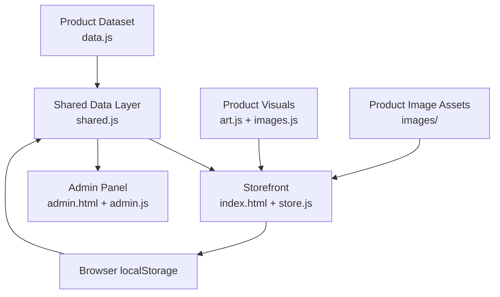
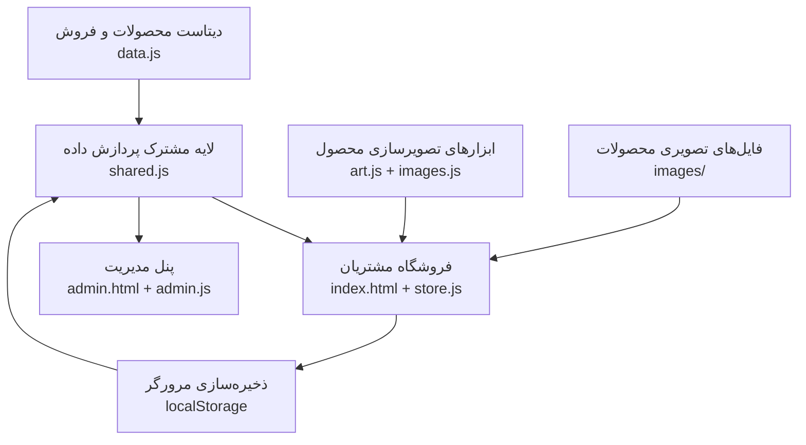

<div align="center">

# BlueStore
### Sales & Inventory Analytics Platform

**A bilingual storefront and sales analytics dashboard built with HTML, CSS and JavaScript.**  
**فروشگاه آنلاین و داشبورد تحلیل فروش با استفاده از HTML، CSS و JavaScript**

<br/>

[](https://dani-labbafi.github.io/test3/)
[](https://github.com/dani-labbafi/test3)

<br/>

**Explore products · Place orders · Track purchases · Analyze sales**

**مشاهده محصولات · ثبت سفارش · پیگیری خرید · تحلیل فروش**

</div>

---

## 🌐 Language / زبان

- [English](#-overview)
- [فارسی](#-معرفی-پروژه)

---

# 🇬🇧 English

## 📌 Overview

BlueStore is a web-based sales platform that combines a customer-facing storefront with an administrative dashboard. It provides a simple shopping workflow while allowing administrators to explore sales activity through key performance indicators, charts, product comparisons and order reports.

The project is designed as a lightweight, browser-based application using standard front-end technologies. It can be deployed as a static website, without requiring a dedicated application server.

> **Current implementation note:** Orders created through the storefront are stored in the browser using `localStorage`. They are not synchronized between different browsers or devices and are not stored in a shared online database.

## ✨ Features

### 🛍️ Customer Storefront
- Browse the product catalog.
- Search and explore products.
- Add products to the shopping cart.
- Review the cart and proceed through checkout.
- Submit an order with customer information.
- Track an order using its order code.

### 📊 Admin Dashboard
- Monitor key sales indicators.
- Explore revenue and order activity over time.
- Review top-performing products.
- Compare product performance.
- Analyze sales by country and order hour.
- Explore order-value distribution.
- Review product revenue contribution through ABC classification.
- Filter and sort product and order tables.
- Inspect order details.
- Export available report data to CSV.

### 📈 Sales Insights
The dashboard includes descriptive analyses intended to help users explore questions such as:

- Which products contribute most to revenue?
- Which products have stronger or weaker sales?
- How are orders distributed across countries?
- At what hours are orders recorded?
- How is revenue distributed among products?
- Which products belong to the A, B or C revenue groups?

## 🧭 Application Structure

BlueStore is organized into two main user experiences:

| Area | Purpose |
|---|---|
| Storefront | Product browsing, cart, checkout and order tracking |
| Admin Panel | Sales KPIs, charts, product analysis, order reports and exports |

## 🏗️ Architecture



The shared data layer provides common data-processing helpers to the storefront and admin panel. Orders submitted through the storefront are saved in browser storage and included in the locally available data.

## 🧰 Technology Stack

| Technology | Role |
|---|---|
| HTML5 | Page structure and application views |
| CSS3 | Layout, styling and responsive presentation |
| JavaScript | Storefront behavior, data processing and dashboard logic |
| SVG | Dashboard chart rendering and product illustrations |
| Browser localStorage | Local persistence for submitted orders |
| CSV | Data import and report export format |
| GitHub Pages | Static website hosting |

## 📁 Project Structure

```text
BlueStore/
│
├── index.html                  # Customer storefront
├── admin.html                  # Administrative dashboard
│
├── data.js                     # Original product and sales dataset
├── shared.js                   # Shared data helpers and local order storage
├── store.js                    # Storefront, cart, checkout and tracking
├── admin.js                    # KPIs, charts, insights, tables and exports
│
├── art.js                      # Product illustration helpers
├── images.js                   # Product image mapping
├── images/                     # Available product image assets
│
└── image-prompts.txt           # Prompts for generating product visuals
```

## 🚀 Getting Started

### Run locally

1. Download or clone the repository.
2. Keep the project files in their original folder structure.
3. Open `index.html` in a modern web browser.
4. Open `admin.html` to access the administrative dashboard.

```bash
git clone https://github.com/dani-labbafi/test3.git
cd test3
```

You can also open the project through a local development server if your browser restricts any local-file functionality.

### Live Demo

Visit the deployed project:

**[Open BlueStore](https://dani-labbafi.github.io/test3/)**

The admin panel is available from the storefront navigation or directly through `admin.html` in the deployed project.

## 📊 Data & Analytics

BlueStore uses a transaction-oriented dataset to display sales activity and calculate descriptive metrics.

The dashboard presents measures such as:

- Total revenue
- Number of orders
- Units sold
- Average order value
- Customer count
- Product count
- Top product by revenue

It also provides product-level comparisons, country-level summaries, hourly order distributions, order-value bands and ABC product classification.

### Important analytical limitations

The current dataset and implementation have limitations that should be considered when interpreting the dashboard:

- The available dates cover a limited period; long-term seasonality and annual trends should not be inferred without a sufficiently broad dataset.
- The current data does not provide reliable inventory-on-hand information.
- Product cost data is not available, so profit and gross margin cannot be calculated.
- Lead times and replenishment data are not available, so optimal reorder quantities and stockout risk cannot be calculated.
- Revenue-based ABC classification is not the same as profit-based or inventory-value classification.
- Orders stored in `localStorage` are local to the browser where they were created.

These limitations are part of the current project scope and should not be interpreted as implemented capabilities.

## 🔐 Data Storage

The current application uses two data sources:

1. The original dataset loaded by the application.
2. Orders submitted through the storefront and stored in the browser's `localStorage`.

This approach is suitable for a front-end demonstration. A production multi-user system would require a backend service, database, authentication and server-side order management.

## 🛣️ Roadmap

Potential future improvements include:

- Connect the application to a shared backend and database.
- Add secure user authentication and role-based access.
- Introduce centralized order management.
- Improve data validation and product identity management.
- Add inventory, cost and supplier datasets when reliable source data becomes available.
- Expand analytics with forecasting and decision-support features.
- Add automated tests for core customer and admin workflows.

*Roadmap items are proposed improvements, not claims about currently available functionality.*

## 👥 Contributors

**Project owner:** [Dani Labbafi](https://github.com/dani-labbafi)

## 📄 License

No license is currently specified in this repository. Unless a license is added, reuse and redistribution permissions should not be assumed.

---

# 🇮🇷 فارسی

## 📌 معرفی پروژه

**BlueStore** یک پلتفرم تحت وب برای نمایش محصولات، ثبت سفارش و تحلیل اطلاعات فروش است. این پروژه از دو بخش اصلی تشکیل شده است: فروشگاه مشتریان و پنل مدیریتی.

در بخش فروشگاه، کاربر می‌تواند محصولات را مشاهده کند، آن‌ها را به سبد خرید اضافه کند، سفارش خود را ثبت کند و با استفاده از کد سفارش وضعیت آن را پیگیری کند. در پنل مدیریت نیز شاخص‌های کلیدی فروش، نمودارها، مقایسه محصولات و گزارش سفارش‌ها در دسترس هستند.

این پروژه با فناوری‌های استاندارد سمت کاربر توسعه داده شده و می‌تواند به‌صورت یک وب‌سایت استاتیک اجرا و میزبانی شود.

> **نکته درباره نسخه فعلی:** سفارش‌های ثبت‌شده در فروشگاه با استفاده از `localStorage` در مرورگر ذخیره می‌شوند. بنابراین اطلاعات سفارش‌ها بین مرورگرها و دستگاه‌های مختلف همگام‌سازی نمی‌شوند و در یک پایگاه داده آنلاین مشترک قرار ندارند.

## ✨ امکانات اصلی

### 🛍️ فروشگاه مشتریان
- مشاهده و مرور فهرست محصولات
- جست‌وجو و بررسی محصولات
- افزودن محصولات به سبد خرید
- مشاهده و مدیریت سبد خرید
- ثبت سفارش و اطلاعات مشتری
- پیگیری سفارش با استفاده از کد سفارش

### 📊 پنل مدیریت
- مشاهده شاخص‌های کلیدی عملکرد فروش
- بررسی روند درآمد و تعداد سفارش‌ها
- شناسایی محصولات پرفروش
- مقایسه عملکرد محصولات
- تحلیل فروش بر اساس کشور و ساعت ثبت سفارش
- بررسی توزیع مبلغ سفارش‌ها
- دسته‌بندی محصولات بر اساس روش ABC و سهم درآمد
- فیلتر و مرتب‌سازی جداول محصولات و سفارش‌ها
- مشاهده جزئیات سفارش
- خروجی گرفتن از داده‌های گزارش در قالب CSV

### 📈 تحلیل و بینش مدیریتی

داشبورد با استفاده از داده‌های موجود به پرسش‌هایی از این قبیل پاسخ می‌دهد:

- کدام محصولات بیشترین سهم را در درآمد دارند؟
- کدام محصولات عملکرد فروش بهتری یا ضعیف‌تری دارند؟
- سفارش‌ها در کشورهای مختلف چگونه توزیع شده‌اند؟
- بیشترین سفارش‌ها در چه ساعت‌هایی ثبت شده‌اند؟
- درآمد میان محصولات چگونه توزیع شده است؟
- محصولات بر اساس سهم درآمد در کدام گروه ABC قرار می‌گیرند؟

## 🧭 ساختار کلی سامانه

BlueStore از دو محیط اصلی تشکیل شده است:

| بخش | کاربرد |
|---|---|
| فروشگاه | مشاهده محصولات، سبد خرید، ثبت سفارش و پیگیری |
| پنل مدیریت | شاخص‌های فروش، نمودارها، تحلیل محصولات، گزارش سفارش‌ها و خروجی داده |

## 🏗️ معماری سیستم



لایه مشترک داده، توابع موردنیاز فروشگاه و پنل مدیریت را فراهم می‌کند. سفارش‌هایی که از طریق فروشگاه ثبت می‌شوند، در فضای ذخیره‌سازی مرورگر قرار می‌گیرند و به داده‌های قابل‌دسترسی همان مرورگر اضافه می‌شوند.

## 🧰 فناوری‌های استفاده‌شده

| فناوری | کاربرد |
|---|---|
| HTML5 | ساختار صفحات و بخش‌های برنامه |
| CSS3 | طراحی رابط کاربری و چیدمان واکنش‌گرا |
| JavaScript | منطق فروشگاه، پردازش داده و عملکرد داشبورد |
| SVG | ترسیم نمودارهای داشبورد و تصویرسازی محصولات |
| localStorage | ذخیره محلی سفارش‌های ثبت‌شده |
| CSV | قالب داده و خروجی گزارش‌ها |
| GitHub Pages | میزبانی وب‌سایت استاتیک |

## 📁 ساختار فایل‌های پروژه

```text
BlueStore/
│
├── index.html                  # فروشگاه مشتریان
├── admin.html                  # پنل مدیریت
│
├── data.js                     # دیتاست اصلی محصولات و فروش
├── shared.js                   # توابع مشترک و ذخیره محلی سفارش‌ها
├── store.js                    # فروشگاه، سبد خرید، ثبت و پیگیری سفارش
├── admin.js                    # شاخص‌ها، نمودارها، تحلیل‌ها و گزارش‌ها
│
├── art.js                      # ابزارهای تصویرسازی محصولات
├── images.js                   # نگاشت تصاویر محصولات
├── images/                     # فایل‌های تصویری محصولات
│
└── image-prompts.txt           # پرامپت‌های تولید تصاویر محصولات
```

## 🚀 راه‌اندازی پروژه

### اجرای محلی

۱. مخزن پروژه را دانلود یا Clone کنید.

۲. تمام فایل‌ها را با حفظ ساختار پوشه‌ها در کنار یکدیگر نگه دارید.

۳. فایل `index.html` را در مرورگر باز کنید.

۴. برای مشاهده پنل مدیریت، فایل `admin.html` را باز کنید.

```bash
git clone https://github.com/dani-labbafi/test3.git
cd test3
```

در صورت وجود محدودیت مرورگر برای اجرای فایل‌های محلی، می‌توانید پروژه را با یک سرور توسعه محلی اجرا کنید.

### نسخه آنلاین

برای مشاهده نسخه منتشرشده پروژه از لینک زیر استفاده کنید:

**[مشاهده BlueStore](https://dani-labbafi.github.io/test3/)**

پنل مدیریت از طریق مسیر `admin.html` نیز در نسخه منتشرشده قابل دسترسی است.

## 📊 داده‌ها و تحلیل‌ها

BlueStore از یک دیتاست مبتنی بر تراکنش برای نمایش فعالیت‌های فروش و محاسبه شاخص‌های توصیفی استفاده می‌کند.

شاخص‌های اصلی داشبورد عبارت‌اند از:

- مجموع درآمد
- تعداد سفارش‌ها
- تعداد واحدهای فروخته‌شده
- میانگین ارزش سفارش
- تعداد مشتریان
- تعداد محصولات
- محصول برتر بر اساس درآمد

علاوه بر این موارد، داشبورد امکان مقایسه محصولات، بررسی فروش کشورها، توزیع سفارش‌ها در ساعات مختلف، دسته‌بندی بازه‌های مبلغ سفارش و طبقه‌بندی ABC محصولات را فراهم می‌کند.

### محدودیت‌های تحلیلی نسخه فعلی

هنگام تفسیر خروجی‌های داشبورد باید محدودیت‌های زیر در نظر گرفته شوند:

- بازه زمانی داده‌های موجود محدود است؛ بنابراین بدون داده کافی نمی‌توان درباره روندهای بلندمدت و فصلی نتیجه‌گیری کرد.
- اطلاعات قابل اتکایی درباره موجودی لحظه‌ای انبار در دسترس نیست.
- بهای تمام‌شده محصولات موجود نیست؛ بنابراین محاسبه سود و حاشیه سود امکان‌پذیر نیست.
- اطلاعات زمان تأمین و سفارش مجدد وجود ندارد؛ بنابراین محاسبه مقدار بهینه سفارش و ریسک اتمام موجودی ممکن نیست.
- طبقه‌بندی ABC بر اساس درآمد، معادل طبقه‌بندی بر اساس سود یا ارزش موجودی نیست.
- سفارش‌های ذخیره‌شده در `localStorage` فقط در مرورگری که سفارش در آن ثبت شده قابل دسترسی هستند.

این موارد محدودیت‌های نسخه فعلی پروژه هستند و نباید به‌عنوان قابلیت‌های پیاده‌سازی‌شده در نظر گرفته شوند.

## 🔐 نحوه ذخیره‌سازی داده‌ها

برنامه در نسخه فعلی از دو منبع داده استفاده می‌کند:

۱. دیتاست اصلی که هنگام اجرای برنامه بارگذاری می‌شود.

۲. سفارش‌هایی که از طریق فروشگاه ثبت شده و در `localStorage` مرورگر ذخیره می‌شوند.

این روش برای نمایش و آزمایش یک پروژه سمت کاربر مناسب است. برای تبدیل آن به یک سامانه چندکاربره و قابل استفاده در محیط واقعی، به بک‌اند، پایگاه داده مشترک، احراز هویت و مدیریت سفارش در سمت سرور نیاز خواهد بود.

## 🛣️ مسیر توسعه آینده

برخی از مسیرهای پیشنهادی برای توسعه نسخه‌های بعدی عبارت‌اند از:

- اتصال سامانه به بک‌اند و پایگاه داده مشترک
- افزودن احراز هویت امن و سطوح دسترسی کاربران
- ایجاد سیستم متمرکز مدیریت سفارش‌ها
- بهبود اعتبارسنجی داده‌ها و مدیریت شناسه محصولات
- افزودن اطلاعات موجودی، هزینه و تأمین‌کنندگان در صورت دسترسی به داده معتبر
- توسعه تحلیل‌ها با قابلیت پیش‌بینی و پشتیبانی تصمیم
- افزودن تست‌های خودکار برای فرایندهای اصلی فروشگاه و پنل مدیریت

*موارد این بخش پیشنهادهای توسعه آینده هستند و به معنای پیاده‌سازی آن‌ها در نسخه فعلی نیستند.*

## 👥 توسعه‌دهنده

**مدیر و توسعه‌دهنده پروژه:** [Dani Labbafi](https://github.com/dani-labbafi)

## 📄 مجوز استفاده

در حال حاضر مجوز مشخصی برای این مخزن ثبت نشده است. تا زمان افزودن یک License معتبر، نباید مجوز استفاده مجدد یا بازتوزیع کد را مفروض دانست.

---

<div align="center">

**BlueStore — From Sales Data to Business Insights**

**بلو‌استور — از داده‌های فروش تا بینش مدیریتی**

</div>
